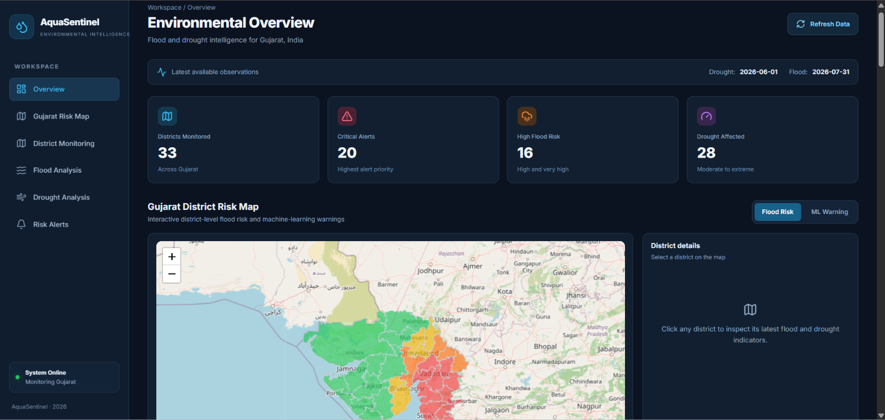
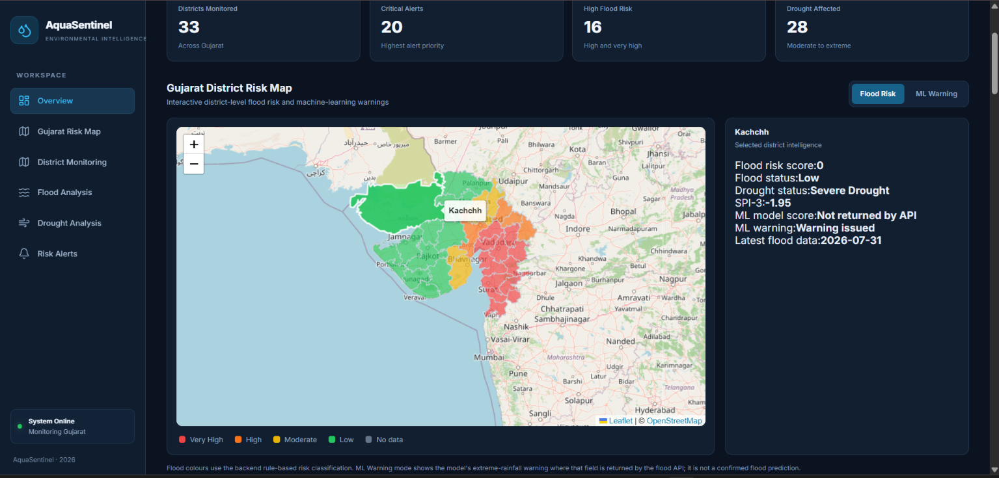
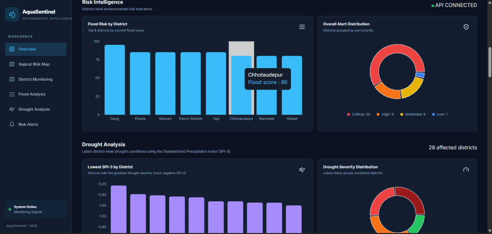
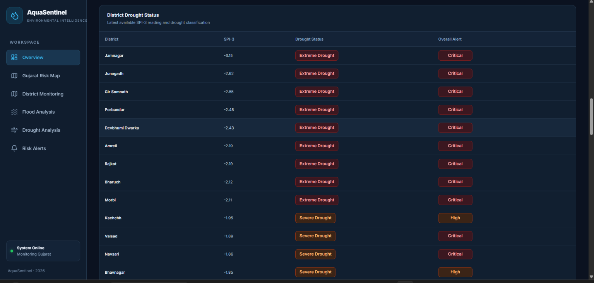
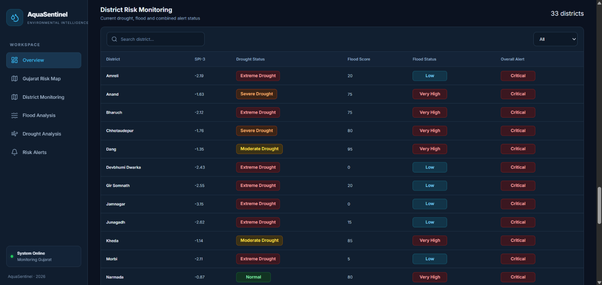

# AquaSentinel
### AI-Powered Flood and Drought Early Warning System for Gujarat

[**Live Application**](https://aquasentinel-fwbv.onrender.com)

---

## 1. Overview

AquaSentinel is an AI-powered environmental risk monitoring platform designed to support flood and drought risk assessment across districts of Gujarat.

The platform combines rainfall-related data, district-level risk analysis, drought indicators, and machine learning-based warnings through an interactive dashboard.

It provides geographical risk visualization and analytical insights to support environmental monitoring and informed decision-making.

## 2. Problem Statement

Floods and droughts are recurring environmental challenges in Gujarat. Monitoring these risks across multiple districts requires access to reliable data and clear analytical insights.

AquaSentinel addresses this challenge by bringing flood risk assessment, drought monitoring, and machine learning-based warnings together in a single platform.

## 3. Features

- **District-Level Flood Risk Map:** Interactive map displaying flood risk across Gujarat districts.
- **Flood Risk Analysis:** Visualizes district-level flood risk classifications.
- **ML-Based Warning System:** Displays machine learning-based extreme rainfall warnings.
- **Drought Analysis:** Monitors drought conditions using the Standardized Precipitation Index (SPI).
- **District-Level Drought Assessment:** Provides drought severity information across 33 districts.
- **Risk Intelligence:** Presents relevant flood and drought risk information through the dashboard.
- **Data Visualization:** Uses charts, statistics, and geographical visualizations to make risk information easier to interpret.

## 4. System Architecture

AquaSentinel follows a unified frontend-backend architecture.

```text
                 User
                   |
                   v
          React + Vite Frontend
                   |
                   v
             FastAPI Backend
                   |
          +--------+--------+
          |        |        |
          v        v        v
        Flood   Drought   Unified
        Engine  Engine    Risk Engine
          |        |        |
          +--------+--------+
                   |
                   v
             Processed Data
                   |
                   v
          Risk Analysis Results
                   |
                   v
          Interactive Dashboard
```

**Deployment Architecture:**

The application is deployed as a single Render Web Service. FastAPI handles API requests and serves the production-built React frontend. Both are accessible through the same application URL.

## 5. Technology Stack

| Component | Technology |
|---|---|
| Frontend | React.js |
| Frontend Build Tool | Vite |
| Backend | Python, FastAPI |
| API Communication | REST API |
| Machine Learning | Python-based ML models |
| Data Processing | Pandas, NumPy |
| Data Visualization | Interactive maps and dashboard charts |
| Deployment | Render |
| Version Control | Git and GitHub |

## 6. Machine Learning and Risk Analysis

AquaSentinel combines different approaches for environmental risk monitoring.

### Flood Risk Assessment

Uses district-level information to classify flood risk into categories and visualize the results on the Gujarat map.

### ML-Based Extreme Rainfall Warning

Uses a machine learning-based warning mechanism to identify potential extreme rainfall conditions.

### Drought Assessment

Uses the Standardized Precipitation Index (SPI) to assess drought severity.

The current drought classification thresholds are:

| SPI Value | Classification |
|---|---|
| SPI ≤ -2.0 | Extreme Drought |
| -2.0 < SPI ≤ -1.5 | Severe Drought |
| -1.5 < SPI ≤ -1.0 | Moderate Drought |
| SPI > -1.0 | Normal |

## 7. API Endpoints

The backend exposes the following REST API endpoints:

| Endpoint | Description |
|---|---|
| `/health` | Backend health check |
| `/api/risk/latest` | Latest unified risk information |
| `/api/flood/latest` | Latest flood risk information |
| `/api/drought/latest` | Latest drought assessment |

These endpoints are accessible through the deployed application domain.

## 8. Installation and Local Setup

### Prerequisites

- Python 3.10+
- Node.js and npm
- Git

### Step 1: Clone the Repository

```bash
git clone https://github.com/harshitarocks07-debug/AquaSentinel.git
cd AquaSentinel
```

### Step 2: Install Backend Dependencies

```bash
cd backend
python -m venv venv
```

Activate the virtual environment on Windows:

```powershell
venv\Scripts\activate
```

Install dependencies:

```bash
pip install -r requirements.txt
```

### Step 3: Install and Build the Frontend

Open another terminal:

```bash
cd frontend
npm install
npm run build
```

### Step 4: Run the Application

From the backend directory, start FastAPI:

```bash
uvicorn app.main:app --reload --port 8000
```

Open the application at:

```text
http://localhost:8000
```

FastAPI serves the built React frontend and handles backend API requests. Therefore, the complete application is accessible through a single local URL.

## 9. Limitations

- Risk assessments depend on the availability and quality of input datasets.
- Machine learning warnings indicate potential conditions and should not be interpreted as confirmed disasters.
- District-level predictions may not capture highly localized weather events.
- The platform is intended for monitoring and decision support, not as a replacement for official disaster management alerts.

## 10. Future Roadmap

- Integrate real-time weather data sources.
- Improve model performance through additional historical datasets.
- Introduce more granular geographical risk assessment.
- Add historical risk trend analysis.
- Improve warning mechanisms and notification capabilities.
- Expand monitoring and analytical capabilities to additional regions.

## 11. Deployment

AquaSentinel is deployed on Render as a single web service.

**Live Application:**  
https://aquasentinel-fwbv.onrender.com

The same URL provides access to the frontend dashboard and backend API services.

## Dashboard Screenshots

### 1. AquaSentinel Overview


### 2. Gujarat District Map


### 3. Risk and Drought Intelligence


### 4. District-Wise Drought Status


### 5. Risk Monitoring


## 12. Project Information

| Category | Details |
|---|---|
| Project | AquaSentinel |
| Domain | Artificial Intelligence and Machine Learning |
| Application Area | Environmental Monitoring |
| Focus | Flood and Drought Risk Assessment |
| Geographical Scope | Gujarat, India |
| Deployment Platform | Render |

---

**AquaSentinel — Enabling data-driven environmental risk monitoring for Gujarat.**
